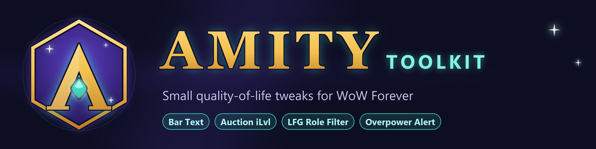

# Amity Toolkit

Quality-of-life modules for **World of Warcraft: Forever** (Interface 16001), bundled in one addon. Each module can be switched on or off from the minimap button or with `/amity`.

| Module              | What it does | Command  |
| ------------------- | ------------ | -------- |
| Bar Text            | Always shows `100/200 50%` health / resource text on player, target and target-of-target | `/abt`   |
| Auction Item Level  | Sortable iLvl column in the auction house browse results | `/ail`   |
| LFG Role Filter     | Tank / Healer / DPS filter buttons in the LFG browse list | `/lfgrf` |
| Overpower Alert     | Warrior Overpower icon with a 5s countdown after a dodge | `/opa`   |

`/amity help` lists every command. Module changes apply after a UI reload; the panel offers a button for it.

## Layout

```
Amity.toc            addon manifest
Core.lua             module registry, saved variables, /amity
Minimap.lua          minimap button
Panel.lua            module toggle panel
Modules/             one file per module
Media/               in-game icons (generated)
curseforge/          logo, banner, description, setup checklist (not packaged)
tools/make_art.py    renders all artwork
tools/build.ps1      builds dist/Amity-<version>.zip
```

## Development

The repo root is the addon folder. Link it into the client as `Amity`:

```
mklink /J "G:\Games\World of Warcraft\_classic_beta_\Interface\AddOns\Amity" "G:\development\repos\amity_wow\amity_wow"
```

Adding a module: create `Modules/<Name>.lua`, call `Amity:RegisterModule(key, { title, notes, defaults, slash })`, implement `M:Init(db)` (and `M:Slash(msg)` if it has a command), and list the file in `Amity.toc`.

Releases: see [curseforge/SETUP.md](curseforge/SETUP.md).
